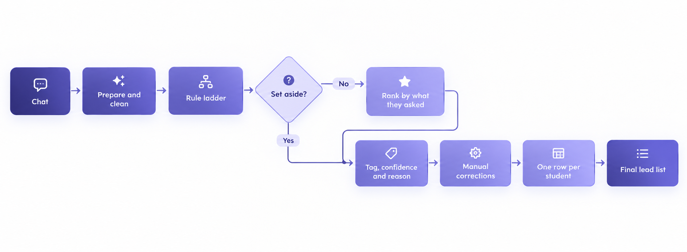
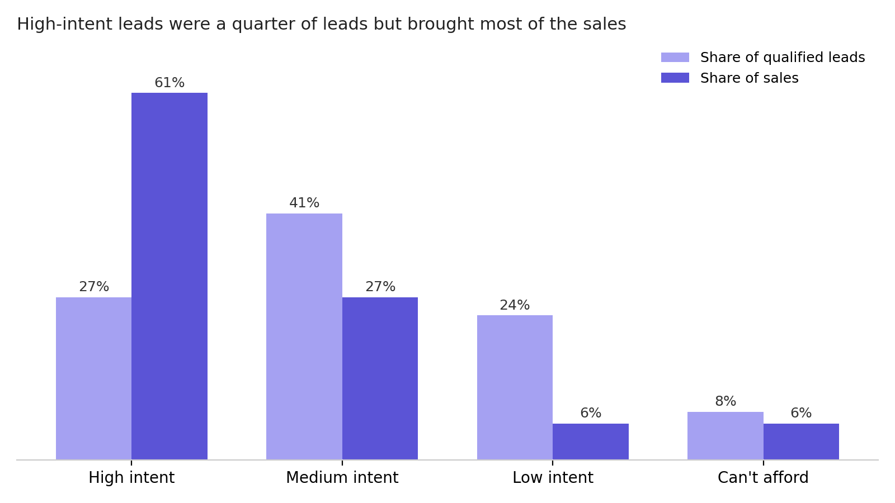

# Rule-based lead classification from customer chats

The sales team had hundreds of chats to get through every day, and no quick way to tell who was serious about buying. I built a rule-based classifier that sorted those chats by buying intent, so agents knew who to call first.

**At a glance**

- 28K+ chats tagged over five months, with the classifier running several times a day.
- Each run pushed high-intent leads into a Google Sheet, so agents always had a fresh list to work from.
- Called first, high-intent leads converted 3 to nearly 9× better than the other tiers. About a quarter of qualified leads brought around 60% of their sales.
- Conversion rose from 1% to 4% in four months.
- Fewer than 0.1% of chats tagged irrelevant ever led to a sale.

---

## The problem

Leads from every channel landed in one chat inbox. A lot of them came from ads that opened a chat with a message already typed out. The student sent it, a bot asked a few questions, and then a sales agent took over.

Not everyone in there was a potential customer. Some sent the pre-typed message and never wrote again. Some were years away from the exam, wanted a course the business didn't offer, or were teachers looking for work. And some were asking about fees, start dates and how to pay. Those were the ones agents needed to reach.

At first glance, all these chats looked the same. Before this, anyone who replied counted as qualified, so "ok" counted the same as "how do I pay?".

Agents had to open chats one by one to work out who was interested. That took time, and students who were ready to buy sat waiting while agents worked through chats that were never going to sell.

So I wanted to answer two things: who should sales contact first, and what were the rest of the chats telling us about lead quality?

---

## Why this was hard

Nobody had tagged these chats before, so there was nothing to check against. In the first week I read and tagged close to 100 chats a day by hand, just to know what "right" looked like.

Lead-scoring tools didn't help either. They work off forms, website visits and tracking data. All we had was the chat, and the chat was messy. Students mixed languages, spelled things however they liked, and asked the same question ten different ways. Even agents wrote "irrelevant" differently.

It also had to keep up. The classifier ran several times a day while agents were working from its output, so a bad rule could show up on the call list within hours. And because the first matching rule decides the tag, moving one rule could change the tags on a lot of chats at once. Every fix had to be re-run on past chats as well as new ones, so it didn't quietly change last week's numbers.

---

## What I built

The classifier gives every chat a tag, a sub-label, a confidence level and a one-line reason.

| Tag | Means |
| --- | --- |
| Qualified | A real student having a real conversation: high intent, medium intent, low intent or can't afford |
| No response | Sent the pre-typed message and nothing else |
| Irrelevant | Not a lead for this course |
| Future lead | A real student, but for a later exam year |

Sales used the tag to decide who to call. Marketing used the sub-label to see why leads were lost, for example whether "can't afford" was growing. No response became its own number, so for the first time you could see how many people sent the pre-typed message and stopped there.

Payment is kept as a separate flag, so a chat can be high intent and paid at the same time. Each chat also records whether an agent replied and how fast, and a gender guessed from name and email, because sales prioritised women.



---

## Why rules, not an AI model

I first drafted an AI version with the same labels, then went with rules. It came down to how often the classifier had to run and how quickly I needed to fix mistakes.

Rules cost nothing to run, so tagging new chats several times a day didn't add up to an API bill. When I changed a rule, I could re-run every past day in seconds. The same chat always got the same tag, which mattered when comparing daily reports. And when a tag was wrong, I could see exactly which rule had produced it.

The downside was upkeep. Students kept finding new ways to say the same thing, so the rules kept growing. Rules also can't read voice notes or catch sarcasm.

---

## How it works

1. **Prepare the chat.** Pull the conversation, mark who sent each message, and remove the pre-typed opening. Each day's tag only uses that day's messages, so later replies don't change it.
2. **Apply the rules in order.** Set aside chats that aren't leads. The agent's call comes first, and "not interested" only counts near the end of a chat, so an objection the agent turned around doesn't count.
3. **Rank by buying intent.** What a student asks matters more than how much they write. "Too expensive" followed by "how do I pay?" counts as high intent.
4. **Apply corrections and remove duplicates.** Hand corrections override the rules, and each student keeps only their best tag per course.
5. **Review and improve the rules.** Compare the rules with hand-checked chats, log every mismatch, fix the rule, and re-run it on past chats.

During the day, it tagged new chats several times and added high-intent leads to the sheet agents used for follow-ups. Once a day, it re-tagged everything, checked for cases the rules had missed, and I confirmed each proposed fix by hand before it went in.

The full walkthrough is in [`model/method.md`](model/method.md).

---

## What I tracked

Each month, for each course, I followed leads from first message to sale: how many replied and how many only sent the pre-typed message, how chats split across tags and intent tiers, and which groups actually bought. That last part mattered most, because it checked the tags against real sales rather than my own judgment. I also tracked the same figures by gender, and how quickly agents replied.

Day to day, I kept a summary row for every run so any day could be compared with the next, an error log for chats that couldn't be pulled, and the rule-change log: what changed, why, and which chat caused it.

---

## Results

The tagging changed how agents spent their day. Instead of working through the inbox in the order chats arrived, they started each round with the students most likely to buy. Because the list refreshed several times a day, those students were picked up the same day they messaged, while they were still interested.

**Effort went where the sales were.** About a quarter of qualified leads were tagged high intent, and they brought around 60% of the sales from qualified leads, converting 3 to nearly 9× better than the other tiers. Some of that comes from being called first, and getting them called first was the whole idea.



**Agents stopped wasting time on dead ends.** Fewer than 0.1% of chats set aside as irrelevant ever led to a sale, so agents could skip them safely. "Can't afford" leads stayed on the list, and they converted better than medium and low intent.

**Conversion went up.** On the main course it went from 1% to 4% in four months. Lead volume dropped over the same period as the season wound down, so not all of that is the tagging. But as the pool shrank, the system made sure the serious students in it got reached first.

---

## What I'd check next

- **Accuracy.** The rules were checked against hand-tagged chats, but never on a separate test set. Next would be a labelled test set, precision and recall for each tag, and a side-by-side with an AI classifier.
- **Future leads.** On the main course they converted at 8.1%, higher than qualified leads. Either next-year students were signing up on schedule, or the "next year" rules were catching students who were ready now.
- **Gender.** It's guessed from name and email only, and 27–37% of qualified leads came out unknown.

---

## Takeaways

The order of the rules is the design. Trusting the agent first, and only counting "not interested" at the end of a chat, removed whole groups of mistakes.

Keep what was said separate from what happened. Payment has its own flag and each day's tag is fixed, so tags stay about intent and don't drift.

Log every rule change with the chat that caused it. It kept the rules easy to explain, and made re-running history safe.

---

## Built with

- **Claude Code** for writing and testing the rules, re-running past days after every fix, and keeping the rule-change log
- **Python** for the rule ladder, the ranking, and keeping one row per student
- **Chatwoot API** for pulling full chat threads, page by page, so long chats weren't cut off
- **Google Sheets** for getting high-intent leads to agents during the day

---

## Repo structure

```
├── README.md
├── assets/
│   ├── leads-vs-sales.png
│   ├── pipeline.png
│   └── rule-fix-loop-image.png
└── model/
    └── method.md
```

---

*Note: Company details and example phrases are generalised. The labels, rules, workflow and results are the ones from production.*
