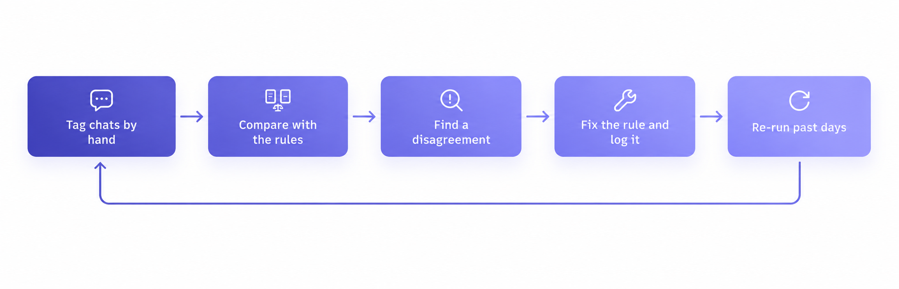

# How the chat tagging works

*How each chat is tagged, how the strongest leads are found, and how the rules got better over time.*

The question was simple: looking at today's chats, who should we call first? Agents had to open every chat to find the serious students, so those students waited behind everyone else. The [README](../README.md) has the full background. This covers how the tagging works.

---

## What each chat gets

Each chat gets a tag, a sub-label, a confidence level and a one-line reason. The buckets are:

| Tag | Means | Sub-labels |
| --- | --- | --- |
| Qualified | A real student having a real conversation | High intent, medium intent, low intent, can't afford |
| No response | Sent the pre-typed message and nothing else | |
| Irrelevant | Not a lead for this course | Agent flagged, wrong exam, spam, no answer on call, general |
| Future lead | A real student, but for a later exam year | |

- **Sales** uses the bucket to decide who to call.
- **Marketing** uses the sub-label to see why leads were lost, for example whether "can't afford" is growing.
- **Payment** is kept as a separate flag, not a bucket, so a chat can be high intent and paid at the same time.

---

## Why rules, not an AI model

Ready-made lead scoring tools didn't fit. They score leads on form fields and website behaviour, like which pages someone visited or whether they filled in a form. All we had was the chat.

And the chat was messy. Students mix languages in the same sentence, and spelling isn't fixed. Even agents typed "irrelevant" several different ways. A tool built for clean English text would miss most of what students actually said.

That left two options: send every chat to an AI model, or write the rules myself. I drafted the AI version first, using the same labels, then went with rules for four reasons:

| Reason | Why it mattered |
| --- | --- |
| **Free to run** | Chats are tagged several times a day, at no cost. |
| **Cheap to re-run** | After every fix, all past days could be re-run in seconds. |
| **Same chat, same answer** | Daily reports need the same tag every time. |
| **Every tag can be explained** | A wrong tag points straight to the rule behind it. |

The cost: every new way of saying something needs a new rule, so the lists keep growing.

---

## Step 1: Preparing the chat

To decide who to call, we first need the whole conversation, cleaned up.

- **Full thread**
    - Pulled in page by page, so long chats aren't cut off.
- **Who said what**
    - Each message is marked as student, agent, bot or system.
    - Voice notes and images can't be read, but are kept as markers.
- **One day at a time**
    - A day's tag uses only that day's messages, so later replies don't change it.
    - If the day has no messages, the full chat is used instead.
- **Pre-typed message removed**
    - Sending it doesn't count as a reply.
- **Agent notes kept**
    - Short notes like "irrelevant" or "called" are read, so the agent's view counts.

---

## Step 2: The rule ladder

With the chat cleaned, everyone who isn't a lead is set aside. The rules are checked in order, and the first one that matches decides the tag.

Three principles shaped the rules:

**1. The agent's word comes first.**
If an agent writes "irrelevant" anywhere in the chat or their notes, the chat is tagged irrelevant, whatever the student said. Agents often decide this on a call, which never shows up in the chat.

**2. Judge how the chat ends, not how it starts.**
A student who says "not interested" in the first message but asks about fees by the end is a lead. That's why the "not interested" check looks only at the last few messages.

**3. Don't drop a real student.**
If they ask about another course the business sells, they go to that course's team.

In practice, a chat is set aside for one of six reasons:

| Set aside because | Example |
| --- | --- |
| No reply | only the pre-typed message |
| Agent ruled them out | "irrelevant" in agent notes |
| Wants something not offered | "a master's degree", "a different exam" |
| Said no | "not interested", "already joined" |
| Not here to buy | "any vacancy", "solve this" |
| Not this year | "next year", "not ready yet" |

"Not this year" becomes a future lead; the rest are tagged no response or irrelevant.

Everyone else goes on to be ranked.

---

## Step 3: Ranking the lead

Everyone left could be a lead. Now the question is who to call first.

Three principles shaped the ranking:

**1. Replying isn't the same as being interested.**
A chat that's only "ok", "yes" or menu taps isn't a lead, however many messages it has.

**2. Talking about price isn't a no.**
"Too expensive" then "how do I pay?" is bargaining, so it's high intent. "Too expensive" alone is still a lead, tagged can't afford.

**3. What they ask matters more than how much they say.**
One question about fees or how to pay outranks a long chat that never gets there.

Each lead then lands in one of five tiers:

| Tier | Example |
| --- | --- |
| High intent | "what are the fees?", "how do I pay", "when can I start" |
| Medium intent | names the course, asks what it covers |
| Low intent | "how does it work?", general questions |
| Can't afford | "too expensive", "out of budget" |
| Not a lead after all | only "ok", "yes", menu taps |

Each tag also gets a confidence level, which goes up when signals agree.

---

## Step 4: Corrections and one row per student

Before the list goes to sales, two final checks:

- **Hand corrections win.** Where a chat has been checked by hand, that tag replaces the rule's tag.
- **One student, one row.** A student who messages on several days gets a tag each day. Only the best one is kept per course, so one person doesn't count as several leads.

"Best" follows this order, with ties going to the higher confidence, then the earliest date:

High intent → Medium intent → Low intent → Can't afford → Future lead → Irrelevant → No response or spam

---

## Step 5: How the rules got better

The first version got things wrong. To fix it, I tagged chats by hand and compared them with the rules. Each mismatch led to a fix, which was logged and re-run on past days to see what else changed.

A few examples:

| Problem | Fix |
| --- | --- |
| Said "not interested" early, then came round | Only the end of the chat is checked |
| Asked about another course the business sells | Sent to that course's team |
| Mentioned an earlier school year they had already finished | Added an exception |

---

## How it runs

It runs in two loops.

**During the day**, several times:

- Pull today's chats and tag them.
- Send high-intent leads straight to the sheet the agents already use.

**Once a day**, as the final version:

- Re-pull every chat and tag it again.
- Run two checks for cases the rules may have missed.
- I confirm every flag before any fix goes in.
- Add the day to the master file, and keep one row per student.

The first loop gets leads to agents quickly. The second gives a fixed record for reporting.

---

## Limitations

The rules were checked against hand-tagged chats, but not on a separate test set. So there's no measured accuracy yet, and no proof they work as well on chats they haven't seen.

New wording, missing context, sarcasm, images and voice notes can all lead to a wrong tag.

The next step is a labelled test set: measure precision and recall for each bucket, and compare the rules against an AI classifier on the same chats.

---

## Takeaways

- **The order of the rules is the design.** Trusting the agent first, and checking "not interested" only at the end, removed whole groups of mistakes.
- **Keep what was said apart from what happened.** Payment is its own flag, and each day's tag is fixed, so tags stay about intent and don't drift.
- **Log every rule change with the chat that caused it.** It kept the rules easy to explain, and made re-running history safe.
- **Consistent isn't the same as correct.** A rule can give the same answer every time and still be wrong. That's why the test set comes next.

---

*Note: Company details and example phrases are generalised. The labels, rules and workflow are the ones that ran in production.*
